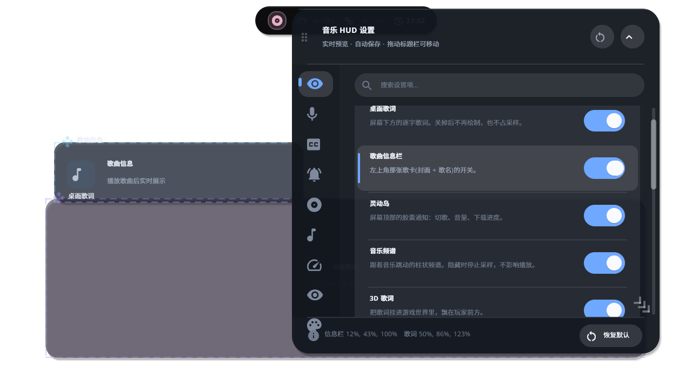

# MuoniumPlayerBedrock

將 [MuoniumPlayer](https://github.com/zihe114514/MuoniumPlayer-multiversion) 移植到 Windows x64 的 Minecraft Bedrock 客戶端。沿用原作 Java 音樂引擎、Skija 介面與歌詞系統；原生 DLL 負責遊戲生命週期、ModMenu 工作頁及 D3D11／D3D12 合成。感謝原作者的支持與技術交流。

**[下載](https://github.com/XuanDiNa/MuoniumPlayerBedrock/releases)** · [安裝](docs/INSTALL.md) · [建置](BUILDING.md) · [授權與來源](docs/DEPENDENCIES.md)

**[0.13.0-test6-esc 測試更新](https://github.com/XuanDiNa/MuoniumPlayerBedrock/releases/tag/v0.13.0-test6-esc)** 遷移至 [ModMenuBE](https://github.com/AFAlimru/ModMenuBE)：local4 的 Configure 保留普通設定，獨立工作頁開啟播放器、HUD 編輯、預設、迷你播放器及已啟用的島內搜尋。**Esc 逐層返回**，最外層退場完成後恢復工作頁，移除額外的返回工作頁浮層及按鈕。local3 沿用 Configure 工具按鈕頁。[遷移及驗收說明](docs/modmenube-migration.md)

**ModMenuBE 需另外安裝**，本包不包含選單或載入器。工作頁依據 `0.2.0-local4` API 驗證，`local3` 使用 Configure 備援；其他 ModMenuBE 版本尚未驗收。舊 public2 使用 ModMenuBedrock／ModMenuBedrockLL，保留供回退，不可混用不同版本 DLL／JAR。

## 選擇版本

| 環境 | 套件名稱包含 | 使用方式 |
| --- | --- | --- |
| 原版 1.26.45.01 / 1.26.51.01 / 1.26.52.03 / 1.26.60.05 | `vanilla-mc26.45-26.51-26.52-26.60` | 同一份原生預載 DLL，依精確遊戲身分自動選擇對應實作 |
| 1.26.60.05，LeviLamina 26.60.7 | `levilamina-mc26.60` | 獨立 LL DLL，使用相容的 ModMenuBE |

首次安裝用 **full.zip**：包含 Java 21、46 個播放器／依賴 JAR、可選房間穿透輔助程式及授權來源。已有完整環境用 **update.zip**。兩者均保留現有設定、帳號、歌單及快取；不存在的預設設定由模組在首次啟動時建立。原版四版本共用一包，LeviLamina 分開；不可互換或同時載入。

本版保留遊戲原生身分、位址與 Arke 防護。記錄的驗證為 Debug／Release 各 40 組、Java 25 項離線測試；完整包另核對執行環境及 DLL／JAR 雜湊。OpenGL 畫面測試受本機 WGL 環境限制，**本版仍待人工遊戲驗收**。執行檔身分不符的其他遊戲映像會被拒絕。

退出遊戲後解壓到實例根目錄，一起替換 DLL、JAR、manifest 及設定描述檔。選用 AI 模型仍按原有流程明確安裝；開頁不會自動播放、登入、下載或停止背景工作。

## 功能

- 原作播放器介面、搜尋、歌單、佇列、循環播放、逐字歌詞與視覺效果。
- 網路／本地播放、漸進緩衝、下一首預取和保留快取選項；兩項快取選項預設關閉。
- 新舊 UI／動畫、迷你播放器、靈動島與可獨立調整的 HUD。
- 客戶端世界定位 3D 歌詞、顏色、更新幀率、方塊局部遮擋及運鏡。
- 場景／材質聲學、固定音源、一起聽房間、可選 Quick Tunnel 輔助程式。
- Windows 媒體控制與外部播放器同步、ModMenuBE 設定／工作頁及組合快捷鍵。

**八項快捷鍵預設無綁定。** 使用 local4 工作頁或 local3 Configure 開啟介面，亦可自行綁定。

## 邊界與待完善

新舊設定介面的離線渲染預覽：

世界定位歌詞與運鏡只改本機顯示，不建立伺服器實體。玩家／生物遮擋仍待完善，不能保證精確輪廓遮擋；方塊遮擋也有採樣限制。一起聽穿透受網路與外部服務影響。Java 版 Simple Voice Chat 廣播尚未移植。音源權限、登入及可選元件依各平台而定，不提供全部付費內容。

## 原作、字型及授權

基於 MuoniumPlayer 2.5.2，固定提交 `9b4cc7e7bd143315da716075a6d024a0d4c0c81b`。保留原作著作權與 [NOTICE](NOTICE)。本專案與 Mojang、Microsoft、網易等平台無官方隸屬關係。

公開版使用 **Noto Sans / Noto Sans CJK（SIL OFL 1.1）** 取代 SF Pro / PingFang；資源別名保留，內容已替換。圖示保留原作來源及公告。主專案採 Apache-2.0；第三方元件保留各自授權，見 [LICENSE](LICENSE)、[第三方元件](docs/DEPENDENCIES.md) 與 `licenses/`。

提供來源及建置工具，本版來源同時包含原生與 LeviLamina 目標，完整包內也附上對應來源與授權。沒有遊戲執行檔、私人帳號或 IDA 資料庫。

## English

A Windows x64 client-side Bedrock port of MuoniumPlayer. **0.13.0-test6-esc** adds ModMenuBE integration: local4 has ordinary Configure plus separate Workspace buttons; local3 retains the owned Configure fallback. Esc dismisses one layer and returns to Workspace after the outermost exit finishes. No extra return banner is added, and focus loss does not stop background work.

Install compatible ModMenuBE separately. Four exact vanilla game versions share one package; LeviLamina 26.60.7 uses a separate package. Full ZIPs include Java 21 and all player dependencies; update ZIPs require an existing complete runtime. Both preserve settings. Native guards remain unchanged. Recorded offline verification is 40 suites per native build mode and 25 Java tests; WGL rendering was unavailable and manual Minecraft acceptance remains pending. Historical public2 stays available for rollback.
