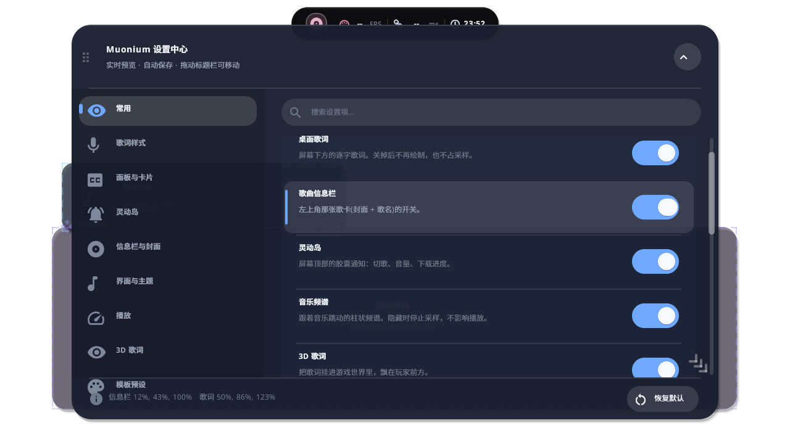

# MuoniumPlayerBedrock

將 [MuoniumPlayer](https://github.com/zihe114514/MuoniumPlayer-multiversion) 移植到 Windows x64 的 Minecraft Bedrock 客戶端。沿用原作 Java 音樂引擎、Skija 介面與歌詞系統；原生 DLL 負責遊戲生命週期、ModMenu 工作頁及 D3D11／D3D12 合成。感謝原作者的支持與技術交流。

**[下載](https://github.com/XuanDiNa/MuoniumPlayerBedrock/releases)** · [安裝](docs/INSTALL.md) · [建置](BUILDING.md) · [授權與來源](docs/DEPENDENCIES.md)

**需要搭配對應遊戲版本的 [ModMenuBedrock](https://github.com/XuanDiNa/ModMenuBedrock)。LeviLamina 環境使用 ModMenuBedrockLL。** 安裝後從播放器的 ModMenu「工作頁」開啟播放器／HUD 編輯；快捷鍵預設無綁定，可自行設定。下載包不包含 ModMenu。

## 選擇版本

| Minecraft | 套件名稱包含 | 基準 DLL | 狀態 |
| --- | --- | --- | --- |
| 1.26.45.01 / 1.26.51.01 | `mc26.45-26.51-native` | 0.12.0-test2 | 使用者已回報可執行 |
| 1.26.52.03 | `mc26.52-native` | 0.10.0-test5 | 使用者已回報可執行 |
| 1.26.60.05，LeviLamina 26.60.7 | `mc26.60-levilamina` | 0.11.0-test7 | 使用者已回報可執行；獨立載入入口 |
| 1.26.60.05，原生預載 | `mc26.60-native-preview` | 0.12.0-test2 | 精確合約與離線驗證；此 DLL 組合待遊戲驗收 |

以上回報來自公開版之前的基準套件。公開版只替換四個字型資源並加入 OFL 授權，原生 DLL 和正式 Java 類別保持不變。新資源已做離線字型／介面檢查，尚未重新人工進遊戲驗收。判斷包含遊戲執行檔雜湊，其他同名或修改過的執行檔可能被拒絕。

首次安裝用 **full.zip**，不要只下載 DLL。`update.zip` 供已有完整執行環境的人更新，保留設定、帳號與歌單。LeviLamina 和原生 DLL 不可互換，也不要同時載入。

## 功能

- 原作播放器介面、搜尋、歌單、佇列、循環播放、逐字歌詞與視覺效果。
- 網路／本地播放、漸進緩衝、下一首預取和保留快取選項；兩項快取選項預設關閉。
- 新舊 UI／動畫、迷你播放器、靈動島與可獨立調整的 HUD。
- 客戶端世界定位 3D 歌詞、顏色、更新幀率、方塊局部遮擋及運鏡。
- 場景／材質聲學、固定音源、一起聽房間、可選 Quick Tunnel 輔助程式。
- Windows 媒體控制與外部播放器同步、ModMenu 工作頁及組合快捷鍵。

**快捷鍵預設無綁定。** 在對應 ModMenu 的工作頁開啟播放器／HUD 編輯，或自行綁定。

## 邊界與待完善

新舊設定介面的離線渲染預覽：

世界定位歌詞與運鏡只改本機顯示，不建立伺服器實體。玩家／生物遮擋仍待完善，不能保證精確輪廓遮擋；方塊遮擋也有採樣限制。一起聽穿透受網路與外部服務影響。Java 版 Simple Voice Chat 廣播尚未移植。音源權限、登入及可選元件依各平台而定，不提供全部付費內容。

## 原作、字型及授權

基於 MuoniumPlayer 2.5.2，固定提交 `9b4cc7e7bd143315da716075a6d024a0d4c0c81b`。保留原作著作權與 [NOTICE](NOTICE)。本專案與 Mojang、Microsoft、網易等平台無官方隸屬關係。

公開版使用 **Noto Sans / Noto Sans CJK（SIL OFL 1.1）** 取代 SF Pro / PingFang；資源別名保留，內容已替換。圖示保留原作來源及公告。主專案採 Apache-2.0；第三方元件保留各自授權，見 [LICENSE](LICENSE)、[第三方元件](docs/DEPENDENCIES.md) 與 `licenses/`。

提供來源及建置工具，舊版 DLL 對應來源另附於 Release。沒有遊戲執行檔、私人帳號或 IDA 資料庫。

## English

A Windows x64 client-side Bedrock port of MuoniumPlayer. The original Java/Skija player runs in an owned companion JVM; a native DLL integrates lifecycle, ModMenu and D3D11/D3D12 composition. Choose the exact game/loader package above. Public editions preserve native DLLs and production Java classes while replacing four text fonts with OFL Noto fonts. Runtime feedback applies to prior baselines; the native 26.60 preview and new font resources have separately stated acceptance limits.
