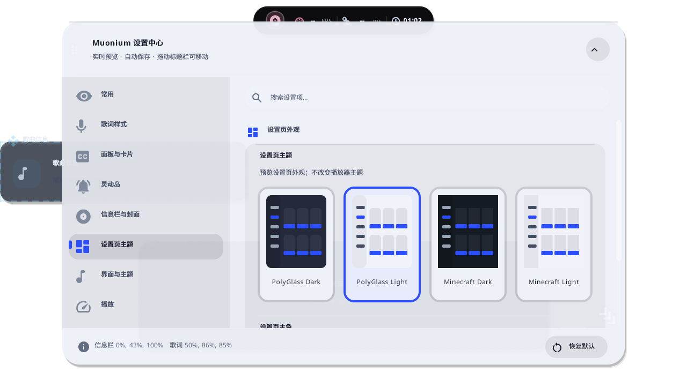

# MuoniumPlayerBedrock

將 [MuoniumPlayer](https://github.com/zihe114514/MuoniumPlayer-multiversion) 移植到 Windows x64 的 Minecraft Bedrock 客戶端。沿用原作 Java 音樂引擎、Skija 介面與歌詞系統；原生 DLL 負責遊戲生命週期、ModMenuBE 整合及 D3D11／D3D12 合成。感謝原作者的支持與技術交流。

**[下載 0.20.2](https://github.com/XuanDiNa/MuoniumPlayerBedrock/releases/tag/v0.20.2)** · [安裝](docs/INSTALL.md) · [建置](BUILDING.md) · [授權與來源](docs/DEPENDENCIES.md)

0.20.2 新增獨立**麥克風增益**：0～400%、每50%一檔、預設100%，即時生效並保存，只調整麥克風。入口為「一起聽 → 直連房間 → 房間語音」，HUD 編輯也能調整。[語音使用說明](docs/ROOM-VOICE.md) · [本版更新](docs/UPDATE-0.20.2.md) · [累計更新及已知限制](docs/RELEASE-0.20.2.md)。

**2026-11-28 緊急熱修復：** 已更新 LeviLamina 完整包／更新包，修正同版遊戲因 GUI／控制台標記或校驗值差異被誤拒載入。維護者已回報測試可用，發布沿用驗收 DLL；原版四版本套件保持原樣。[熱修復說明與來源](docs/HOTFIX-0.20.2-20261128.md)。

## 安裝

**需另外安裝相容的 [ModMenuBE](https://github.com/AFAlimru/ModMenuBE) 與載入器**。本包不包含選單、遊戲或遊戲伺服器插件。

工作頁需要另外安裝提供 **Workspace V1 API** 的 ModMenuBE。完整整合候選為 [review7 分支](https://github.com/XuanDiNa/ModMenuBE/tree/codex/review7-settings-fixes)，來源 commit `020adfdd3a43fd1abb3feba838925431baddfd3e`，包含被動設定頁、選用原生入口與工作頁。此分支仍在上游審查，manifest 版本為 `0.2.1`，不代表上游已正式發布或合併。ModMenuBE 側已完成 Windows Debug／Release 與 Android arm64 離線驗證；**這份新 DLL 與 Muonium 0.20.2 的遊戲內配對仍待驗收**。更新前請完全退出遊戲並保留設定。

歷史 `local3` Configure 工具按鈕備援保留；舊版 ModMenuBedrock 套件不可混用。

| 環境 | 套件名稱包含 |
| --- | --- |
| 原版 1.26.45.01／1.26.51.01／1.26.52.03／1.26.60.05 | `vanilla-mc26.45-26.51-26.52-26.60` |
| 1.26.60.05，LeviLamina 26.60.7 | `levilamina-mc26.60` |

首次安裝選 **full.zip**，包含 Java21、播放器依賴、Opus 語音編解碼器、可選穿透輔助程式及授權來源。已有完整環境可選 **update.zip**。原版四版本共用一包，LeviLamina 獨立分包，兩者不可同時載入。

完全退出 Minecraft，再解壓到實例根目錄，一起替換 DLL、JAR、manifest 及設定描述檔。套件保留現有設定、帳號、歌單與快取；缺少的預設設定由首次啟動建立。十項快捷鍵預設未綁定。未改動遊戲 EXE 或 ModMenuBE DLL，保留原生掛鉤防護；只容許已驗證內容的兩項非程式 PE 標記差異，詳見熱修復說明。

## 功能

- 搜尋、帳號歌單、播放佇列、循環、逐字歌詞及視覺效果；同步上游2.6.1的音源與帳號功能。
- 漸進串流、響度均衡與自然快混；下一首預取、保留媒體快取預設關閉，支援快取清單、路徑與容量設定。
- 保留新舊UI；HUD編輯包含四種設定頁主題、主色及動畫選項、迷你播放器與靈動島。
- 世界定位3D歌詞、更新幀率選項、方塊局部遮擋、場景／材質聲學及運鏡路線預檢與平滑處理。
- 一起聽直連房間、可選公網穿透、連接代理及延遲顯示；Windows媒體控制與外部播放器同步。
- 純客戶端房間語音、麥克風／拒聽快捷鍵、輸入輸出裝置選擇及當前音樂廣播。
- 可選距離音訊：8／16／32／64格、左右方向感與方塊悶音。房主需在線，最多八名語音參與者；不需伺服器插件。

距離模式需雙方確認同一世界，明確啟用後才分享暫態位置；不會自動核對同服。拒聽同時停止收聽與送音。各項收音與廣播功能預設關閉，開頁不會自動開麥、播放或登入。

## 驗證與限制

普通與距離語音已由玩家確認可用。0.20.2麥克風增益通過離線音訊與回歸驗證，依維護者決定跳過額外實體麥克風測試；不代表所有硬體或跨網路環境都已驗收。驗證詳見隨包`VERIFICATION.json`，歷史測試參考見 [TESTING.md](TESTING.md)。

**YouTube尚未完全修復**，可能起播失敗、途中停播或尾段不完整。官方頁面播放需已安裝Chrome／Edge並完成模組自有瀏覽器登入；播放瀏覽器在背景執行，登入頁仍正常顯示。Spotify OAuth需使用者自己的Client ID。音源可用性取決於平台授權、帳號、地區與網路。

玩家／生物的精確輪廓遮擋仍待完善，方塊遮擋及聲場有採樣範圍限制。穿透與TCP弱網／跨國穩定性仍有限。房間語音沒有回聲消除、降噪或自動同服尋房，未移植Java Simple Voice Chat協定。

## English

Emergency hotfix (2026-11-28): the LeviLamina full/update assets now include the
maintainer-tested loading fix for checksum and GUI/console metadata differences.
Vanilla assets are unchanged. See the [scope and matching source](docs/HOTFIX-0.20.2-20261128.md).

A Windows x64 client port of MuoniumPlayer for Minecraft Bedrock, retaining the upstream Java music engine and Skija UI with native D3D11/D3D12 composition. Thanks to the original author for support and technical guidance.

Supports vanilla **1.26.45.01 / 1.26.51.01 / 1.26.52.03 / 1.26.60.05** in one package; **LeviLamina 26.60.7 on 1.26.60.05** uses a separate package. Install the loader separately. Workspace requires a separately installed ModMenuBE with the **Workspace V1 API**. The complete integration candidate is the [review7 branch](https://github.com/XuanDiNa/ModMenuBE/tree/codex/review7-settings-fixes), commit `020adfdd3a43fd1abb3feba838925431baddfd3e`, including passive settings, optional native entry and Workspace. This branch is under upstream review; its manifest version remains `0.2.1`, and it is not an upstream release or merge. The ModMenuBE candidate has Windows Debug/Release and Android arm64 offline verification, but **in-game pairing of this new DLL with Muonium 0.20.2 is still pending**. Exit the game before updating and retain settings. Use the full ZIP for a first installation, or the update ZIP with an existing complete runtime. Exit the game before replacing files; settings are preserved.

Includes upstream 2.6.1 music features, old/new UI and settings themes, lyrics, cinematic camera, scene acoustics, synchronized listening, client-only room voice and music broadcast. The host stays online; no game server addon is required. Optional distance audio needs explicit same-world consent. Version 0.20.2 adds independent microphone gain, 0–400%, default 100%.

Ordinary and distance voice were user-confirmed. Extra physical microphone acceptance for the new gain control was explicitly skipped; offline checks do not cover all devices or networks. YouTube playback still has unresolved startup/early-stop/tail failures. Entity lyric occlusion and weak-network tunneling remain limited. See the [bilingual release notes](docs/RELEASE-0.20.2.md).

## 授權

Apache-2.0；第三方元件保留各自條款，包含LGPL／MPL元件及對應來源。公開包使用可再散布的Noto字型，詳見 [NOTICE](NOTICE)、[依賴來源](docs/DEPENDENCIES.md) 與`licenses/`。本專案不提供繞過平台付費或版權限制的功能。
