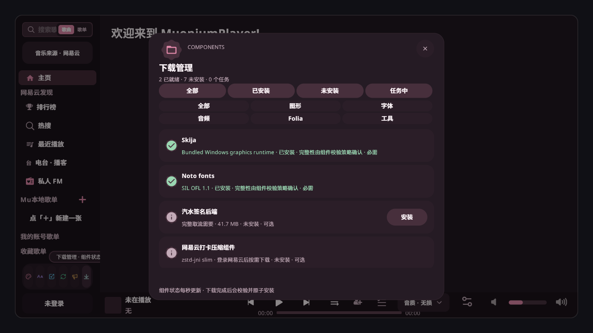

# 0.15.0：同步上游 2.6.0 正式版

來源：MuoniumPlayer-multiversion 官方標籤 `2.6.0`，固定提交
`eb541684e9d681d8145f5f9d681cf31980646dc7`。相較先前固定的
`cda0c7e9` 開發快照，已同步 116 個有變動的收錄檔案。

使用者提供的 `MuoniumPlayer-26.3-fabric-2.6.0.jar` 用於功能和類別核對，
SHA-256 為 `392A870C04B71143CBC8ACB0EA21E27E26B185C667E7703CF68F9191200F7056`。
原檔要求 Java 25；Bedrock 仍由來源編譯 Java 21 主程式，不載入或附送 Fabric 原檔。

## 更新內容

- 下載管理：在播放器側欄集中查看選用元件的安裝狀態、進度、失敗及重試。
  Bedrock 已內附的 Skija 和 Noto 字型顯示已安裝，不提供重複安裝按鈕。
  不列出 Java 專用 MuoniumConfig。只開啟頁面不會開始下載。
  下載管理與播放器工具各有獨立入口；窄側欄圖示隨按鈕寬度收縮，避免重疊。
- 字型選擇：同步分類、篩選、版面與動態效果改進。保留公開版 Noto 字型與授權，
  停用原作在繪製時重試下載專有字型包的路徑；自選字型仍沿用原有入口。
- 智能混音：同步可選的三段動態 EQ 與相關分析；預設關閉。
  Bedrock 串流預分析亦將此選項納入設定身分，切換後不採用舊設定的工作結果。
- Bilibili：以選中分 P 的實際時長顯示播放進度，不採整部影片總長。
  播放取鏈得到的有效時長只適用同一曲目，且不覆寫保存的歌單資料。
  保留 Bedrock 的 CDN 備援、原請求標頭與邊下邊播。
- 運鏡：同步上游包含速度資訊的 Hermite 插值，保留路線預檢、碰撞、距離界限、
  閒置與輸入防護，以及 `ll-coexist2` 原生相機共存修補。
- 場景聲學：同步直達聲雙延遲交叉淡化、早期反射、混響與空間切換調整。
- 桌面歌詞：同步對齊設定及相關修正。

下載管理的離線自有視窗預覽：

## 保留與邊界

原版 `1.26.45.01 / 1.26.51.01 / 1.26.52.03 / 1.26.60.05` 共用一包；
LeviLamina `26.60.7` 使用獨立套件。ModMenuBE 另外安裝，既有設定、帳號、歌單不覆寫。
全版和更新版都包含相同的新 DLL／JAR；全版另附 Java 21 執行環境及對應完整來源。

快捷鍵維持預設無綁定。預下載下一首與保留音樂快取維持預設關閉。
依照先前要求，上游公告、贊助彈窗及自動抓取仍停用。關閉或失焦不停止背景工作。
玩家／生物深度遮擋、Java 語音廣播等未完成項目不因來源同步而宣稱完成。

本輪原生遊戲掛鉤、RVA、相機布局與渲染防護沒有變更；DLL 的原生來源變動只有
版本資訊與經核對的設定描述檔雜湊配對。離線及自有視窗測試不等於遊戲內驗收，
不代表已證實 FPS 提升或全面解決音源權限／網路問題。

安裝和本輪集中測試見 [TESTING.md](../TESTING.md)。
